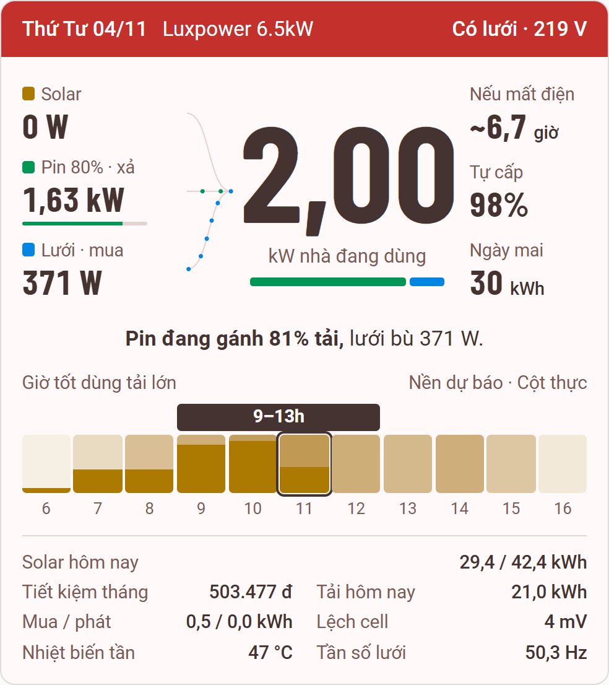

# Solar Almanac

Card Lovelace cho Home Assistant, trình bày hệ điện mặt trời như **tờ lịch của hôm nay**: nhìn một lần biết nhà đang dùng bao nhiêu, điện từ đâu tới, mất điện thì pin chạy được bao lâu và giờ nào nên bật tải lớn.

Không gắn với hãng biến tần nào: chỉ cần sensor công suất `pv`, `battery`, `grid`; hệ không có pin thì khai thêm `load`. Phần còn lại là tuỳ chọn, thiếu entity nào phần tương ứng tự ẩn.



Lấy cảm hứng từ [sunsynk-power-flow-card](https://github.com/slipx06/sunsynk-power-flow-card) (MIT, © slipx06).

## Cài đặt

Qua HACS: **HACS → Custom repositories**, thêm `ngoviet/solar-almanac-card` với loại **Dashboard**, rồi cài **Solar Almanac**. Bản build `dist/solar-almanac-card.js` có sẵn trong repo nên không cần tự build.

Cài tay:

1. Chép `dist/solar-almanac-card.js` vào `config/www/solar-almanac-card.js` của HA
2. Thêm resource: **Settings → Dashboards → Resources** → `/local/solar-almanac-card.js` (JavaScript module)

## Cấu hình

Tối thiểu:

```yaml
type: custom:solar-almanac-card
entities:
  pv: sensor.pv_power
  battery: sensor.battery_power
  battery_soc: sensor.battery_soc
  grid: sensor.grid_power
```

Đầy đủ, ví dụ với LuxPower và Solcast:

```yaml
type: custom:solar-almanac-card
title: Luxpower 6.5kW
battery_capacity: 17.15   # kWh, để tính giờ còn chạy và giờ đầy
battery_reserve: 2        # %, mức biến tần ngừng xả khi mất lưới
entities:
  pv: sensor.luxpower_inverter_pv_pv_power
  battery: sensor.luxpower_inverter_battery_battery_flow
  battery_soc: sensor.luxpower_inverter_battery_battery_soc
  grid: sensor.luxpower_inverter_grid_grid_flow
  pv_today: sensor.luxpower_inverter_pv_pv_energy_today
  load_today: sensor.luxpower_inverter_home_consumption_today_calculated
  grid_import_today: sensor.luxpower_inverter_grid_energy_from_grid_today
  grid_export_today: sensor.luxpower_inverter_grid_energy_to_grid_today
  forecast_today: sensor.technology_solcast_pv_forecast_forecast_today
  forecast_tomorrow: sensor.technology_solcast_pv_forecast_forecast_tomorrow
  grid_voltage: sensor.luxpower_inverter_grid_grid_voltage
  grid_frequency: sensor.luxpower_inverter_grid_grid_frequency
  grid_connected: binary_sensor.luxpower_inverter_grid_grid_connected
```

### Tuỳ chọn

| Tuỳ chọn           | Mặc định | Ý nghĩa                                                        |
|--------------------|----------|----------------------------------------------------------------|
| `title`            | —        | Tên hiện trên băng đỏ, ẩn khi card quá hẹp                     |
| `theme`            | `auto`   | `auto` theo chế độ sáng/tối của HA, hoặc `light`, `dark`       |
| `compact`          | `false`  | Ẩn dải giờ và dòng chữ nhỏ                                     |
| `threshold`        | `10`     | W, dưới mức này coi như không có dòng chảy                     |
| `battery_capacity` | —        | kWh, cần để hiện "Nếu mất điện" và "Đầy sau"                   |
| `battery_reserve`  | `0`      | %, phần pin không dùng khi tính thời gian còn chạy             |
| `forecast_attribute` | tự dò  | Tên thuộc tính dự báo; tự dò `detailedHourly`, `detailedForecast`, `watts` |
| `cell_delta_warn`  | —        | mV, vượt ngưỡng này hiện cảnh báo bằng chữ dưới băng đỏ        |
| `inverter_temperature_warn` | — | Như trên, cho nhiệt độ biến tần                               |

### Entity

| Entity                                                    | Dùng cho                                       |
|-----------------------------------------------------------|------------------------------------------------|
| `pv`, `battery`, `grid`                                   | Ba nguồn và đường hạt                          |
| `load`                                                    | Số to giữa card; bỏ trống thì tự tính pv + battery + grid, chỉ khi khai đủ cả ba. Hệ không có pin phải khai `load` |
| `battery_soc`                                             | Phần trăm pin, thanh SOC                       |
| `pv_today`, `load_today`, `grid_import_today`, `grid_export_today` | Tổng ngày; `grid_import_today` và `load_today` tạo chỉ số Tự cấp |
| `forecast_today`, `forecast_tomorrow`                     | Giá trị kWh, cộng thuộc tính dự báo theo giờ để dựng dải giờ |
| `grid_connected`, `grid_voltage`                          | Trạng thái lưới trên băng đỏ, báo mất lưới     |
| `savings_month`, `cell_delta`, `inverter_temperature`, `grid_frequency` | Dòng chữ nhỏ cuối tờ             |

Mỗi entity viết dạng chuỗi, hoặc dạng object khi cần đảo dấu:

```yaml
battery:
  entity: sensor.battery_power
  invert: true   # nếu biến tần báo dương = sạc
```

Quy ước dấu (sau `invert`):

| Entity  | Dương        | Âm        |
|---------|--------------|-----------|
| pv      | đang phát    | —         |
| battery | xả           | sạc       |
| grid    | mua điện     | bán điện  |
| load    | tiêu thụ     | —         |

Card tự quy đổi theo `unit_of_measurement`: công suất nhận `W`, `kW`; năng lượng nhận `Wh`, `kWh`, `MWh`; `cell_delta` nhận `mV`, `V`.

Nguồn đã khai mà không đọc được thì dòng của nó hiện `—`, thanh tỉ lệ và câu trạng thái ẩn; riêng lúc `grid_connected` báo mất lưới thì lưới được tính bằng 0. Không có `load` mà thiếu một trong ba nguồn thì không tính được tải: số to giữa card hiện `—`, thanh tỉ lệ và câu trạng thái ẩn.

### Dải giờ

"Giờ tốt dùng tải lớn" là chuỗi giờ liền nhau quanh giờ đỉnh, có dự báo từ 70% đỉnh trở lên. Khi khung giờ hôm nay đã qua, dải giờ chuyển sang ngày mai.

Thuộc tính dự báo có thể là mảng dòng (`period_start`, `datetime` hoặc `time` đi với `pv_estimate` tính bằng kW, hoặc `watts`, `power` tính bằng W) hoặc object `{thời điểm: W}`. Không có dự báo thì dải chỉ hiện sản lượng thực theo giờ, đọc từ lịch sử của `pv` và làm mới mỗi 5 phút.

## Phát triển

```bash
npm install
npm run dev        # mở dev/index.html với dữ liệu giả
npm run build      # typecheck + build ra dist/
npm run watch      # build lại mỗi khi sửa
```

- `src/solar-almanac-card.ts` — card chính (Lit)
- `src/flows.ts` — phân bổ công suất, định dạng số, câu trạng thái, khung giờ tốt
- `src/history.ts` — lịch sử trong ngày và dự báo theo giờ
- `src/theme.ts` — màu sáng/tối sinh bằng palette-axi
- `src/font.ts` — font số nhúng base64
- `src/types.ts` — kiểu config và `hass`
- `dev/` — trang thử với `hass` giả, có các tình huống sạc, xả, phát lưới, mất lưới, thiếu dữ liệu
- `PRODUCT.md`, `DESIGN.md` — định hướng sản phẩm và hệ thiết kế

## Giấy phép

MIT. Font số Barlow Condensed © The Barlow Project Authors, nhúng dưới SIL Open Font License 1.1, xem [licenses/Barlow-OFL.txt](licenses/Barlow-OFL.txt).
