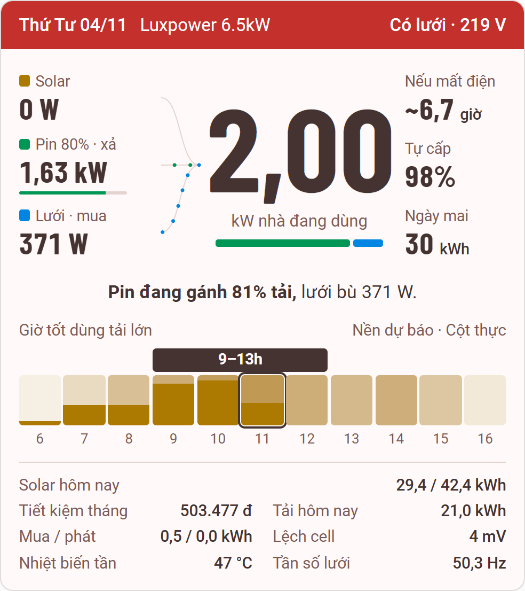

# Solar Almanac

Card Lovelace cho Home Assistant, trình bày hệ điện mặt trời như **tờ lịch của hôm nay**: nhìn một lần biết nhà đang dùng bao nhiêu, điện từ đâu tới, mất điện thì pin chạy được bao lâu và giờ nào nên bật tải lớn.

Không gắn với hãng biến tần nào: chỉ cần sensor công suất `pv`, `battery`, `grid`; hệ không có pin hoặc không nối lưới thì khai thêm `load`. Phần còn lại là tuỳ chọn, thiếu entity nào phần tương ứng tự ẩn.



Lấy cảm hứng từ [sunsynk-power-flow-card](https://github.com/slipx06/sunsynk-power-flow-card) (MIT, © slipx06).

## Cài đặt

Qua HACS: **HACS → Custom repositories**, thêm `ngoviet/solar-almanac-card` với loại **Dashboard**, rồi cài **Solar Almanac**. Bản build `dist/solar-almanac-card.js` có sẵn trong repo nên không cần tự build.

Cài tay:

1. Chép `dist/solar-almanac-card.js` vào `config/www/solar-almanac-card.js` của HA
2. Thêm resource: **Settings → Dashboards → Resources** → `/local/solar-almanac-card.js` (JavaScript module)

## Cấu hình

Tối thiểu:

```yaml
type: custom:solar-almanac-card
entities:
  pv: sensor.pv_power
  battery: sensor.battery_power
  battery_soc: sensor.battery_soc
  grid: sensor.grid_power
```

Đầy đủ, ví dụ với LuxPower và Solcast:

```yaml
type: custom:solar-almanac-card
title: Luxpower 6.5kW
battery_capacity: 17.15   # kWh, để tính giờ còn chạy và giờ đầy
battery_reserve: 2        # %, mức biến tần ngừng xả khi mất lưới
entities:
  pv: sensor.luxpower_inverter_pv_pv_power
  battery: sensor.luxpower_inverter_battery_battery_flow
  battery_soc: sensor.luxpower_inverter_battery_battery_soc
  grid: sensor.luxpower_inverter_grid_grid_flow
  pv_today: sensor.luxpower_inverter_pv_pv_energy_today
  load_today: sensor.luxpower_inverter_home_consumption_today_calculated
  grid_import_today: sensor.luxpower_inverter_grid_energy_from_grid_today
  grid_export_today: sensor.luxpower_inverter_grid_energy_to_grid_today
  battery_charge_today: sensor.luxpower_inverter_charge_energy_today
  battery_discharge_today: sensor.luxpower_inverter_discharge_energy_today
  forecast_today: sensor.technology_solcast_pv_forecast_forecast_today
  forecast_tomorrow: sensor.technology_solcast_pv_forecast_forecast_tomorrow
  grid_voltage: sensor.luxpower_inverter_grid_grid_voltage
  grid_frequency: sensor.luxpower_inverter_grid_grid_frequency
  grid_connected: binary_sensor.luxpower_inverter_grid_grid_connected
  # Khu điều khiển, bỏ trống thì không hiện
  fan: light.luxpower_fan_controller_luxpower_fan_both_speed
  fan_rpm:
    - sensor.luxpower_fan_controller_fan_1_rpm
    - sensor.luxpower_fan_controller_fan_2_rpm
  fan_auto: input_boolean.luxpower_dual_fan_auto_speed
  fan_stall: binary_sensor.luxpower_fan_controller_luxpower_fan_controller_fan_stall_alarm
  eod: number.luxpower_inverter_battery_on_grid_cut_off_soc
```

### Tuỳ chọn

| Tuỳ chọn           | Mặc định | Ý nghĩa                                                        |
|--------------------|----------|----------------------------------------------------------------|
| `title`            | —        | Tên hiện trên băng đỏ, ẩn khi card quá hẹp                     |
| `theme`            | `auto`   | `auto` theo chế độ sáng/tối của HA, hoặc `light`, `dark`       |
| `compact`          | `false`  | Ẩn dải giờ và dòng chữ nhỏ; khu điều khiển vẫn hiện            |
| `layout`           | `columns` | `flow`: thay ba số lớn và dải hạt bằng sơ đồ Solar trên, lưới trái, nhà phải, pin dưới, nối qua biến tần; dây dày theo công suất, chấm chạy theo chiều dòng. Không có lưới thì pin sang trái. Phần còn lại của card giữ nguyên. `inverter`: sơ đồ kiểu Sunsynk, Solar và các ô PV trên trái, pin dưới trái, biến tần giữa, nhà trên phải, lưới dưới phải, dây gấp khúc; số liệu trong ngày của từng nút đứng ngay cạnh nút (xem dưới) |
| `flow_max_power`   | `5000`   | W, công suất ứng với dây dày nhất ở `layout: flow` và `inverter` |
| `mppts`            | —        | Danh sách MPPT cho `layout: flow` và `inverter`: mỗi mục `name`, `power`, `voltage`, `current`, `energy_today`. Ở `flow` hiện thành các ô cùng hàng với nút Solar, nửa đầu bên trái, nửa sau bên phải; ở `inverter` là một hàng ô dưới nút Solar, dây từ đáy mỗi ô gom về biến tần (công suất, điện áp · dòng, kWh hôm nay) |
| `threshold`        | `10`     | W, dưới mức này coi như không có dòng chảy                     |
| `battery_capacity` | —        | kWh, cần để hiện "Nếu mất điện" và "Đầy sau"                   |
| `battery_reserve`  | `0`      | %, phần pin không dùng khi tính thời gian còn chạy             |
| `forecast_attribute` | tự dò  | Tên thuộc tính dự báo; tự dò `detailedHourly`, `detailedForecast`, `watts` |
| `cell_delta_warn`  | —        | mV, vượt ngưỡng này hiện cảnh báo bằng chữ dưới băng đỏ        |
| `inverter_temperature_warn` | — | Như trên, cho nhiệt độ biến tần                               |
| `eod_levels`       | `[10, 20, 30]` | %, các mức bấm nhanh cho `eod`                           |
| `savings_label`    | `Tiết kiệm tháng` | Nhãn dòng `savings_month`, ví dụ `Tiết kiệm kỳ này`   |
| `battery_period_label` | `Sạc / xả tháng` | Nhãn dòng `battery_charge_period` và `battery_discharge_period` |
| `band`             | `red`             | Màu băng đầu card: `red` hoặc `neutral`; cảnh báo vẫn đỏ |
| `animation`        | `auto`            | Hạt chạy trên dây: `auto` dừng khi hệ điều hành bật giảm chuyển động (Windows tắt hiệu ứng hoạt ảnh cũng tính là bật), `on` (hoặc `true`) luôn chạy, `off` (hoặc `false`) không chạy |

### Entity

| Entity                                                    | Dùng cho                                       |
|-----------------------------------------------------------|------------------------------------------------|
| `pv`, `battery`, `grid`                                   | Ba nguồn và đường hạt                          |
| `load`                                                    | Số "Nhà đang dùng"; bỏ trống thì tự tính pv + battery + grid, chỉ khi khai đủ cả ba. Hệ không có pin hoặc không khai `grid` (hệ 25.6V DC) phải khai `load`, nếu không thì mất số nhà đang dùng, thời gian còn chạy và dòng "Pin còn" |
| `battery_soc`                                             | Phần trăm pin, thanh SOC                       |
| `pv_today`, `load_today`, `grid_import_today`, `grid_export_today` | Tổng ngày; `grid_import_today` và `load_today` tạo chỉ số Tự cấp |
| `battery_charge_today`, `battery_discharge_today` | kWh sạc vào và xả ra khỏi pin trong ngày, dòng "Sạc / xả hôm nay" |
| `battery_charge_period`, `battery_discharge_period` | Như trên nhưng theo tháng hoặc kỳ; nhãn dòng đặt bằng `battery_period_label` (mặc định "Sạc / xả tháng") |
| `forecast_today`, `forecast_tomorrow`                     | Giá trị kWh, cộng thuộc tính dự báo theo giờ để dựng dải giờ |
| `grid_connected`, `grid_voltage`                          | Trạng thái lưới trên băng đỏ, báo mất lưới; bấm vào mở lịch sử `grid_voltage` |
| `savings_month`, `cell_delta`, `inverter_temperature`, `grid_frequency` | Dòng chữ nhỏ cuối tờ             |
| `fan`, `fan_rpm`, `fan_auto`                              | Dòng quạt tản nhiệt: `fan` (light, fan hoặc switch) cho biết bật/tắt, `fan_rpm` một hoặc danh sách sensor vòng quay, hiện số lớn nhất; `fan_auto` (input_boolean hoặc switch) thành nút Tự động |
| `fan_stall`                                               | binary_sensor, `on` thì hiện cảnh báo quạt kẹt dưới băng đỏ |
| `eod`                                                     | Dòng EOD lưới: entity `number` (hoặc `input_number`) là SOC pin ngừng xả khi còn lưới, mỗi mức trong `eod_levels` là một nút |

### Khu điều khiển

Khai `fan`, `fan_rpm` hoặc `eod` thì cuối card có thêm khu điều khiển; không khai, hoặc entity không có trong HA, thì khu đó tự bỏ qua. Nút Tự động bật/tắt `fan_auto`. Nút mức EOD gọi `<domain>.set_value` và HA hỏi xác nhận trước khi ghi, vì giá trị này ghi thẳng vào biến tần; bấm mức đang chọn thì không làm gì. Bấm nhãn bên trái mở chi tiết entity.

Mỗi entity viết dạng chuỗi, hoặc dạng object khi cần đảo dấu:

```yaml
battery:
  entity: sensor.battery_power
  invert: true   # nếu biến tần báo dương = sạc
```

Quy ước dấu (sau `invert`):

| Entity  | Dương        | Âm        |
|---------|--------------|-----------|
| pv      | đang phát    | —         |
| battery | xả           | sạc       |
| grid    | mua điện     | bán điện  |
| load    | tiêu thụ     | —         |

Card tự quy đổi theo `unit_of_measurement`: công suất nhận `W`, `kW`; năng lượng nhận `Wh`, `kWh`, `MWh`; `cell_delta` nhận `mV`, `V`.

Nguồn đã khai mà không đọc được thì dòng của nó hiện `—`, thanh tỉ lệ và câu trạng thái ẩn; riêng lúc `grid_connected` báo mất lưới thì lưới được tính bằng 0. Không có `load` mà thiếu một trong ba nguồn thì không tính được tải: số nhà đang dùng hiện `—`, thanh tỉ lệ và câu trạng thái ẩn. Hệ không có pin hoặc không nối lưới (không khai `grid`) luôn thiếu nguồn trong ba nguồn, nên phải khai `load` mới có số nhà đang dùng, thời gian còn chạy và dòng "Pin còn" ở cột dự phòng.

### Sơ đồ `layout: inverter`

Bố cục quen thuộc của card Sunsynk, vẽ lại bằng chữ HTML nên chữ không nhỏ dưới 12px trên điện thoại. Mỗi nút gom số liệu của chính nó:

| Nút | Hiện cạnh nút |
|-----|---------------|
| Solar (trên trái) | công suất, thanh và số "hôm nay / dự báo", dự báo ngày mai; hàng ô PV bên dưới |
| Pin (dưới trái) | SOC (biểu tượng pin đầy theo SOC), sạc/xả lúc này, sạc / xả hôm nay, thời gian còn chạy, lệch cell |
| Biến tần (giữa) | nhiệt độ biến tần, đỏ khi vượt `inverter_temperature_warn` |
| Nhà (trên phải) | công suất, thanh tỉ lệ nguồn và "% từ …", tải hôm nay, tự cấp |
| Lưới (dưới phải) | công suất, mua / phát hôm nay, điện áp · tần số; băng đầu card chỉ còn "Có lưới" / "Mất lưới" |

Dưới sơ đồ giữ câu trạng thái, dải giờ, khu điều khiển; chữ nhỏ cuối tờ chỉ còn các dòng không thuộc nút nào (tiết kiệm, sạc / xả theo kỳ). Không có lưới thì nhà xuống hàng dưới, nối thẳng với biến tần. Thiếu nút chứa một mục (khai `battery_soc` mà không khai `battery`, hoặc `forecast_tomorrow` mà không khai `pv`) thì "Nếu mất điện" / "Pin còn" và "Ngày mai" hiện ở hàng dự phòng dưới sơ đồ.

### Dải giờ

"Giờ tốt dùng tải lớn" là chuỗi giờ liền nhau quanh giờ đỉnh, có dự báo từ 70% đỉnh trở lên. Khi khung giờ hôm nay đã qua, dải giờ chuyển sang ngày mai.

Thuộc tính dự báo có thể là mảng dòng (`period_start`, `datetime` hoặc `time` đi với `pv_estimate` tính bằng kW, hoặc `watts`, `power` tính bằng W) hoặc object `{thời điểm: W}`. Không có dự báo thì dải chỉ hiện sản lượng thực theo giờ, đọc từ lịch sử của `pv` và làm mới mỗi 5 phút.

## Phát triển

```bash
npm install
npm run dev        # mở dev/index.html với dữ liệu giả
npm run build      # typecheck + build ra dist/
npm run watch      # build lại mỗi khi sửa
```

- `src/solar-almanac-card.ts` — card chính (Lit)
- `src/flows.ts` — phân bổ công suất, định dạng số, câu trạng thái, khung giờ tốt
- `src/history.ts` — lịch sử trong ngày và dự báo theo giờ
- `src/theme.ts` — màu sáng/tối sinh bằng palette-axi
- `src/font.ts` — font số nhúng base64
- `src/types.ts` — kiểu config và `hass`
- `dev/` — trang thử với `hass` giả, có các tình huống sạc, xả, phát lưới, mất lưới, cảnh báo, quạt tắt, thiếu dữ liệu. Tham số: `?flow`, `?inverter` (thêm `=1`, `=3` để đổi số ô MPPT), `&dc` bỏ lưới/quạt/EOD như hệ DC, `&kb=N` mở sẵn tình huống thứ N, `&auto` sáng/tối theo trình duyệt
- `PRODUCT.md`, `DESIGN.md` — định hướng sản phẩm và hệ thiết kế

## Giấy phép

MIT. Font số Barlow Condensed © The Barlow Project Authors, nhúng dưới SIL Open Font License 1.1, xem [licenses/Barlow-OFL.txt](licenses/Barlow-OFL.txt).
